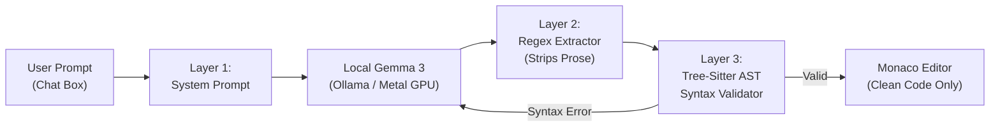

# 🔒 OfflineCoder

> **100% Offline, Local-First AI Code Generator powered by Google Gemma**  
> *Zero conversational prose. Zero internet access. Pure, runnable code only.*

[](file:///README.md)
[](https://ollama.com)
[](https://ai.google.dev/gemma)
[](LICENSE)

---

## ⚡ Quick Cheatsheet (TL;DR)

Save these two commands. You can run them anytime—even months from now—to start or completely turn off the platform:

| Goal | Terminal Command | Result |
| :--- | :--- | :--- |
| **🚀 Start Everything** | `make start` | Boots Ollama + Backend on port `8000` & **automatically opens browser** |
| **🌐 Web Address** | `http://127.0.0.1:8000` | Open in any browser on your machine |
| **🛑 Stop & Free Memory** | `make stop` | Kills all background processes & **frees 100% of RAM and GPU VRAM** |
| **🔬 Diagnostics** | `make doctor` | Runs health check on Ollama, Gemma models, ports, and memory |

> **From Anywhere on Your Mac (Even `~`):**
> ```bash
> # Start
> cd Documents/Antigravity/useoffline && make start
> 
> # Emergency Kill (Immediately frees all RAM from anywhere)
> pkill -9 -f uvicorn; pkill -9 -f ollama
> ```

---

## 📖 What is OfflineCoder?

**OfflineCoder** is a local-first web platform where you type a coding prompt and receive **clean, runnable code only**—with no explanations, no pleasantries, and no conversational wrapper.

All neural network inference executes 100% locally on your machine's hardware (Apple Silicon Metal GPU or NVIDIA CUDA) using Google's open-weights **Gemma** models. **Zero network calls leave your machine at runtime.**



---

## 🛡️ Core Highlights

### 1. Three-Layer Code-Only Enforcement
- **Layer 1 (System Prompt):** Instructs the model to output solely a single fenced code block in the requested language.
- **Layer 2 (Post-Processor):** Deterministic regex extraction that discards any chatty conversational headers (`"Sure, here is your code..."`) and footers (`"Hope this helps!"`).
- **Layer 3 (Tree-Sitter AST Validator):** Validates syntax offline using `tree-sitter` and language parsers. If syntax errors exist, it automatically re-prompts Gemma with the AST error node for up to 2 auto-retries before displaying.

### 2. Zero-Egress Network Guarantees
- Outbound requests are blocked at both the browser CSP and FastAPI backend middleware levels.
- Strict Content Security Policy (CSP):
  ```http
  Content-Security-Policy: default-src 'self'; connect-src 'self' http://localhost:* ws://localhost:* http://127.0.0.1:* ws://127.0.0.1:* ws: wss:; font-src 'self' data:; img-src 'self' data: blob:; script-src 'self' 'unsafe-eval' 'unsafe-inline';
  ```
- **Live Offline Badge:** Live indicator in the top navbar that intercepts and turns red if any external connection attempt is made.
- Self-hosted Monaco Editor (VS Code's editor engine) with local Web Workers—zero external CDN links, no Google Fonts, no external scripts.
- **PWA (Progressive Web App):** Built-in Service Worker precaches all UI assets so the frontend loads instantly even with Wi-Fi completely turned off.

### 3. Local History & Snippets
- Built-in offline SQLite database (`offlinecoder.db`).
- Full searchable history of all generated snippets, token counts, duration, and syntax validation status.
- One-click **Save Snippet**, **Copy Code**, and **Download File** (with matching extension: `.py`, `.ts`, `.cpp`, `.rs`, etc.).

### 4. Sandboxed Code Runner
- Optional isolated code execution for Python and JavaScript.
- Runs inside a secure subprocess with resource limits (256 MB RAM cap, 5s timeout, zero network access).

---

## 💻 Hardware Requirements & Model Guide

| Model | Quantization | Size | Min RAM | Recommended | Best For |
| :--- | :--- | :--- | :--- | :--- | :--- |
| **gemma:2b** | `Q4_K_M` | ~1.6 GB | 4 GB | 8 GB | Older machines, ultra-fast generation |
| **gemma3:latest** *(Default)* | `Q4_K_M` | ~3.3 GB | 8 GB | 16 GB | Default balanced model; excellent code syntax |
| **codegemma:7b** | `Q4_K_M` | ~5.0 GB | 12 GB | 16+ GB | Complex algorithms & multi-file architectures |

---

## 🛠️ Complete Makefile Command Reference

All daily workflows are wrapped into simple `make` targets:

```bash
# Start Ollama + Backend and automatically open browser
make start

# Stop all processes and release 100% of RAM/VRAM
make stop

# Run full system diagnostics (checks Ollama, models, RAM, ports)
make doctor

# Run development mode (concurrent Vite frontend + FastAPI reloader)
make dev

# Run FastAPI backend alone on port 8000
make backend

# Run Vite dev frontend alone on port 5173
make frontend

# Build production frontend bundle into frontend/dist
make build

# Run backend Pytest test suite (15 unit and e2e tests)
make test

# One-time helper to pre-download recommended Gemma models
make download-models
```

---

## 📱 Accessing from Mobile / Other Devices

You can use OfflineCoder from your phone (iOS / Android) or tablet while the AI runs on your Mac's hardware:

### Option A: Local Wi-Fi (Home / Private Network)
1. Ensure your Mac and phone are on the same Wi-Fi.
2. Find your Mac's local IP: `ipconfig getifaddr en0` (e.g. `192.168.1.50`).
3. Open Chrome or Safari on your phone and go to:
   ```text
   http://<YOUR_MAC_IP>:8000
   ```
4. Tap Chrome menu (`⋮`) -> **"Add to Home screen"** / **"Install App"** to run OfflineCoder as a full-screen mobile app.

### Option B: Tailscale Mesh VPN (Works Anywhere & Bypasses Campus AP Isolation)
On university/office Wi-Fi with client isolation, use [Tailscale](https://tailscale.com) (free private mesh VPN):
1. Install Tailscale on your Mac and phone.
2. Sign in to both with the same account.
3. Open Chrome on your phone and go to:
   ```text
   http://<MAC_TAILSCALE_IP>:8000
   ```

---

## 🐳 Docker Deployment (Zero-Egress Container)

To run OfflineCoder as fully isolated containers with no external internet gateway:

```bash
docker compose up -d
```

The `docker-compose.yml` configures an internal bridge network (`internal: true`) which blocks outbound internet gateway access while allowing the backend, frontend, and Ollama containers to communicate locally.

---

## 🧪 Disconnect Wi-Fi Verification Test

To verify complete offline operation:

1. Launch OfflineCoder:
   ```bash
   make start
   ```
2. **Turn off your Wi-Fi** or disconnect your ethernet cable.
3. Refresh `http://127.0.0.1:8000`.
4. Type:
   ```text
   binary search in python
   ```
5. Click **Generate**:
   - Code streams into Monaco Editor in 2–3 seconds.
   - Output contains strictly valid Python code—zero explanations.
   - The green **"Offline mode: ON"** badge confirms zero external packets were sent.

---

## 📁 Repository Architecture

```
useoffline/
├── start.sh                 # 1-click bootstrapper (Ollama + Backend + Browser)
├── stop.sh                  # 1-click terminator (releases 100% RAM/VRAM)
├── Makefile                 # Daily CLI workflow commands
├── docker-compose.yml       # Zero-egress isolated container orchestration
├── scripts/
│   ├── doctor.sh            # Complete environment & port diagnostic suite
│   └── download_models.sh   # One-time online model pre-download helper
├── backend/
│   ├── app/
│   │   ├── main.py          # FastAPI app, security headers & offline checks
│   │   ├── config.py        # Pydantic v2 configuration
│   │   ├── api/             # Endpoints: /generate, /models, /history, /system, /run
│   │   ├── services/
│   │   │   ├── llm.py       # Local Ollama client & streaming engine
│   │   │   ├── postprocess.py # Regex fenced block extractor & prose stripper
│   │   │   ├── validate.py  # Tree-sitter AST syntax validator & retry loop
│   │   │   └── sandbox.py   # Isolated subprocess execution sandbox
│   │   └── db/              # SQLAlchemy SQLite models & schema
│   ├── tests/               # 15 automated pytest unit and e2e tests
│   └── requirements.txt
└── frontend/
    ├── src/
    │   ├── components/      # MonacoEditor, PromptBox, HistorySidebar, Settings
    │   ├── store/           # Zustand application state with safe JSON parsing
    │   └── main.tsx         # Local Monaco worker registration & PWA setup
    ├── vite.config.ts       # Local proxy & Workbox PWA caching configuration
    └── package.json
```

---

## 🔬 Testing

Run the full automated test suite offline:

```bash
make test
```

```text
======================== 15 passed, 1 warning in 0.20s =========================
```

---

## 📄 License

MIT © [Abhayraj Singh](https://github.com/TheAbhayAlgorithms). Built for speed, privacy, and offline productivity.
